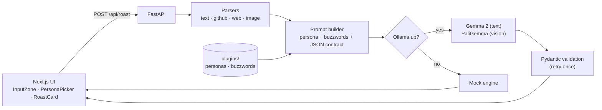

<div align="center">

# 🔥 RoastScribe

**The brutally honest, viral AI product critic — powered by Google Gemma 2 & PaliGemma, running locally.**

Drop in an idea, a GitHub repo, a live site or a UI screenshot.
Get a savage roast, then a genuinely useful **Rescue Arc**, on a shareable receipt.

[](LICENSE)
[](CONTRIBUTING.md)
[](CONTRIBUTING.md)
[](../../labels/good%20first%20issue)
[](https://ollama.com/library/gemma2)

</div>

> 📸 *Demo screenshot: run the app (below), roast something, hit **Download Receipt**, and drop the PNG at `docs/demo.png`.*

## ✨ Features

- **4 input types** — elevator pitch, GitHub repo (README, deps, commits), live website (title, hero, CTAs) or screenshot (PaliGemma vision → Gemma 2).
- **4 personas × 3 spice levels** — Cynical VC, Chef Gordon, Senior Architect, Gen Z Founder.
- **Roast + Rescue** — every burn is anchored in a real flaw, followed by the fatal flaw, who'd actually pay, and a realistic pivot.
- **Viral receipt card** — dotted borders, barcode, verdict stamp, 3 themes, 1-click PNG export, share to X / LinkedIn.
- **Local-first** — runs on Ollama. **No Ollama? No problem:** an automatic mock engine keeps the app working out of the box.
- **Plugin architecture** — personas and buzzword lists are plain JSON; parsers and card themes are single files.

## 🏗️ Architecture



## 🚀 Quickstart

**Prerequisites:** Python 3.10+, Node 18+, and (optionally) [Ollama](https://ollama.com).

### 1. Model *(pick one, or neither for the mock engine)*

**Hosted Gemma (API key):** create a key at <https://aistudio.google.com/apikey>, then put `GEMMA_API_KEY=...` in `backend/.env` (see `backend/.env.example`). Order of preference: API key → Ollama → mock.

**Local Ollama:**

```bash
ollama pull gemma2:2b        # or gemma2:9b for sharper burns
ollama run gemma2:2b         # keep it running
# for screenshots:
ollama pull paligemma
```

### 2. Backend

```bash
cd backend
python -m venv .venv
# Windows: .venv\Scripts\activate    macOS/Linux: source .venv/bin/activate
pip install -r requirements.txt
python run.py                # http://localhost:8000  ·  API docs at /docs
```

### 3. Frontend

```bash
cd frontend
cp .env.example .env.local   # optional
npm install
npm run dev                  # http://localhost:3000 (Next picks 3001+ if busy)
```

The result card shows `engine: gemma` or `engine: mock` so you always know which one answered.

## ⚙️ Configuration

| Env var | Default | Purpose |
|---|---|---|
| `GEMMA_API_KEY` | *(none)* | Hosted Gemma via [Google AI Studio](https://aistudio.google.com/apikey). Takes priority over Ollama |
| `GEMMA_API_MODEL` | *(auto)* | Pin a model id; empty = auto-pick the best Gemma your key supports (see `/api/status`) |
| `OLLAMA_HOST` | `http://localhost:11434` | Ollama endpoint |
| `ROAST_TEXT_MODEL` | `gemma2:2b` | Text model |
| `ROAST_VISION_MODEL` | `paligemma` | Screenshot captioning model |
| `ROAST_FORCE_MOCK` | *(off)* | `1` to always use the mock engine |
| `GITHUB_TOKEN` | *(none)* | Raises GitHub API rate limits |
| `NEXT_PUBLIC_API_URL` | `http://localhost:8000` | Backend URL for the frontend |

## 🔌 API

`POST /api/roast`

```json
{ "input_type": "idea | github | url | image",
  "content": "text, URL, owner/repo, or base64 image",
  "persona": "cynical_vc",
  "spice_level": 2 }
```

Returns `product_name`, `one_line_summary`, `roast_title`, `the_burn[]`, `cringe_metrics`, `the_rescue` (plus `engine`). `GET /api/personas` lists loaded personas.

## 🧪 Tests

```bash
cd backend && pytest -q                         # parsers use mocked HTTP; no network needed
cd frontend && npm run lint && npm run build
```

## 🎃 Contributing

Hacktoberfest-friendly! Add a **persona** (one JSON file), a **parser**, a **buzzword list** or a **card theme**. Start with [CONTRIBUTING.md](CONTRIBUTING.md) and look for `good first issue`.

Roasts target **products, never people** — see the [Code of Conduct](CODE_OF_CONDUCT.md).

## 📄 License

[MIT](LICENSE)
